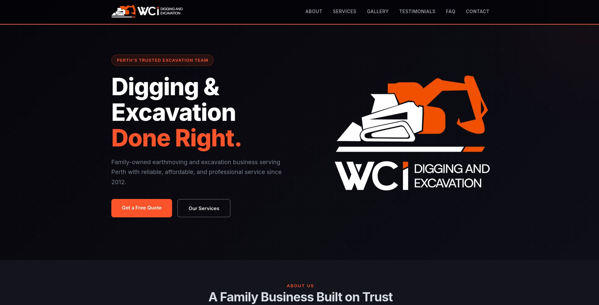

# WCI Digging & Excavation

A clean, modern website for a Perth-based excavation and earthmoving business. Built with plain HTML, CSS, and JavaScript -- no frameworks, no build tools, no bloated dependencies.

[](LICENSE)

Built for [WCI Digging & Excavation](https://wci-dig.com), designed and developed by [DeSynkro](https://desynkro.com) with assistance from [Opencode](https://opencode.ai).

## Quick start

```bash
docker compose up -d
```

Open http://localhost:8080

No Docker? Just open `index.html` in your browser.

## Screenshots



## Structure

```
├── index.html              Main website
├── docker-compose.yml      Nginx setup
├── css/
│   └── style.css           All styles
├── js/
│   └── main.js             All logic
├── images/
│   ├── WCI Logo Side.webp
│   ├── WCI Logo.webp
│   ├── aboutus.jpg
│   ├── embed.jpg
│   ├── favicon.png
│   ├── thumbnail.jpg
│   └── jobs/               Gallery photos (10)
├── HOSTING.md              Hosting & ops guide
├── LICENSE                 MIT
└── README.md               This file
```

## About

This is the real website powering [wci-dig.com](https://wci-dig.com) -- a family-owned excavation team serving the Perth metro area since 2012. It was built to be fast, accessible, and easy to maintain.

## Features

- Responsive design (desktop + mobile)
- Smooth scroll navigation
- Services carousel
- Testimonial carousel with autoplay and navigation
- Photo gallery with lightbox viewer
- FAQ accordion with ARIA accessibility
- SEO metadata (structured data, Open Graph)
- Keyboard and screen-reader friendly
- Zero dependencies -- just HTML, CSS, and JavaScript
- Docker support for easy deployment

## Tech Stack

| What | How |
|------|-----|
| Structure | HTML5 with semantic landmarks |
| Styling | CSS3 (custom properties, flexbox, grid, animations) |
| Logic | Vanilla JavaScript (no libraries) |
| Icons | Inline SVG |
| Font | Inter (Google Fonts) |
| Server | Nginx via Docker Compose |

## Deployment

The site runs in an Nginx Docker container. See [HOSTING.md](HOSTING.md) for the full hosting and operations guide.

## License

MIT -- see [LICENSE](LICENSE).

## Credits

- Built for [WCI Digging & Excavation](https://wci-dig.com)
- Designed and developed by [DeSynkro](https://desynkro.com)
- Assisted by [Opencode](https://opencode.ai)
